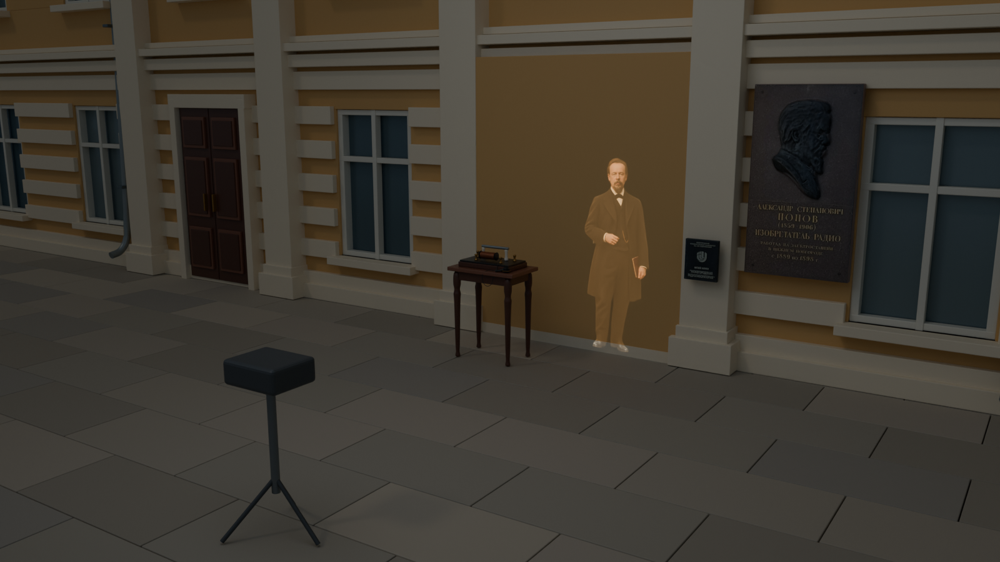

# Проектор Попова

Русскоязычный музейный аватар Александра Попова для Mac и проектора. Ноутбук озвучивает входящий текст и отрисовывает губы по фонемам и громкости, акценты бровями и небольшие движения головы. Голос формантный, синтетический. Для работы в зале достаточно проводного дисплея и звукового выхода. После установки зависимостей интернет не требуется.

[Демонстрация с общим и крупным планами](Ответ%20про%20приёмник.mp4) · [Установка в Blender](Модели/Установка%20проектора.blend) · [Инструкция для площадки](Как%20запустить%20проекцию.md)



## Запуск на Mac

Проверено на Apple Silicon с macOS, Python 3.12 и установленными инструментами командной строки Xcode. Для опубликованных колёс зависимостей на Apple Silicon требуется macOS 14 или новее.

```sh
git clone https://github.com/antony502189-max/popov-projector.git
cd popov-projector
./setup.command
open "Пульт Попова.app"
```

Установщик создаёт локальную `.venv`, загружает закреплённые зависимости, проверяет синтез и собирает исполняемое приложение из Swift. При нестандартной установке Python передайте путь через `POPOV_PYTHON`. Библиотека eSpeak NG и русский словарь поставляются внутри колеса piper-tts. Пульт вызывает формантный движок через C API.

## Как разговаривать

- **Начать экскурсию** запускает готовый рассказ «У радиоприёмника» продолжительностью примерно десять минут. Текст лежит в папке **Примеры**.
- **Произнести** озвучивает текст из поля. Выделение `**слова**` усиливает смысловой акцент. В режиме **Вопрос посетителя** пульт выбирает подготовленный ответ по теме вопроса.
- **Перебить** отменяет текущий рассказ и очередь, затем сразу озвучивает текст из поля или отвечает на вопрос. **СТОП** гасит проекцию и звук до ручного возобновления.
- В настройках macOS выберите для проектора расширенный дисплей. В пульте выберите его имя и нажмите **Вывести**. До подключения доступно отдельное пробное окно.

## Вход для приложения

Локальный адаптер на ноутбуке может послать команду через закрытый Unix-сокет. Одна UTF-8 JSON-команда на соединение, строка завершается переводом строки. Утилита `control.py` использует стандартную библиотеку Python и показывает ответ в JSON.

```sh
python3 Исходники/control.py say --file "Примеры/У радиоприёмника.txt" --id tour-01
python3 Исходники/control.py event --id tour-01
python3 Исходники/control.py ask "Как работает приёмник?" --interrupt
python3 Исходники/control.py stop
python3 Исходники/control.py resume
```

`say` принимает до 32 000 знаков, `ask` — вопрос до 400 знаков. В очереди помещаются пять команд помимо активной. В рамках текущего запуска повтор идентификатора с тем же содержимым возвращает его прежний статус. Ограничение срока относится к началу воспроизведения. Уже звучащая экскурсия продолжается и после истечения этого срока. Микрофон и сетевой транспорт мобильного приложения подключаются отдельно.

## Как устроено воспроизведение

1. Сервис делит рассказ по предложениям, сохраняя выделение слов. Для быстрого старта первый фрагмент ограничен 88 знаками, последующие — 180. Синтез следующей порции идёт во время воспроизведения. В очереди аудиодвижка одновременно до трёх фрагментов.
2. Прогретый eSpeak NG возвращает моно PCM с частотой 22 050 Гц и временные метки фонем. В памяти хранятся первые фразы типовых ответов, а также недавние результаты. Кэш ограничен 48 фрагментами и 12 МиБ PCM.
3. Между процессами передаются сырой PCM и разметка. Заголовок содержит две 32-битные длины в сетевом порядке, за ними — JSON и звуковые байты. AVAudioEngine запускается при открытии пульта. Один AVAudioPlayerNode последовательно выводит порции без повторного открытия аудиоустройства. На границах предложений сохранены короткие речевые паузы.
4. SpriteKit выбирает позу по позиции аудиоузла в отсчётах. Переходы губ и усиление артикуляции читаются по времени того же фрагмента. Счётчик `underruns` показывает случаи, когда к моменту постановки порции часы узла уже прошли конец предыдущей.

## Проверка на своей установке

```sh
# Пульт должен быть открыт, в очереди не должно быть других реплик.
python3 Исходники/latency.py
python3 Исходники/soak.py "Примеры/У радиоприёмника.txt"
```

Первый скрипт измеряет время от принятия 20 разных текстов до запуска первого буфера. Второй проигрывает экскурсию в реальном времени и проверяет длительность, завершение каждого фрагмента и счётчик опустошений. Встроенная метка задержки на пульте и на стене позволяет отдельно оценить задержку конкретного проектора.

### Результаты на Apple M2 Pro

| Проверка | Результат |
| --- | --- |
| 20 разных реплик, медиана приёма текста до запуска первого буфера | 12 мс |
| Те же 20 реплик, 95-й процентиль / максимум | 22 / 26 мс |
| Повтор вопроса о приёмнике, 8 попыток, медиана | 6,5 мс |
| Экскурсия «У радиоприёмника», реальное время аудио | 10 мин 36,1 с |
| Подтверждения сыгранных фрагментов / опустошения буфера | 170 из 170 / 0 |

Пульт был прогрет, для замера использовался звуковой выход Mac с нулевой тестовой громкостью. На предыдущей версии медиана тех же 20 реплик составляла 28,5 мс. В проверке прерывания прежний рассказ и ожидающий текст получили статус `cancelled`, а ответ посетителю — `finished`. При проверке мимики на живых аудиочасах позиции росли последовательно во всех трёх фрагментах ответа. Акустическую задержку колонок и задержку изображения на стене нужно измерять на установленном оборудовании.

В каталоге **Исходники** находятся код пульта, сервис, озвучка, рендер демонстрации и экспорт поз. В **Модели** находятся самодостаточные сцены Blender для рига и установки. В **Ресурсы** — подготовленные текстуры поз для показа. Сведения об источниках сохранены в [атрибуции](CREDITS.md).
